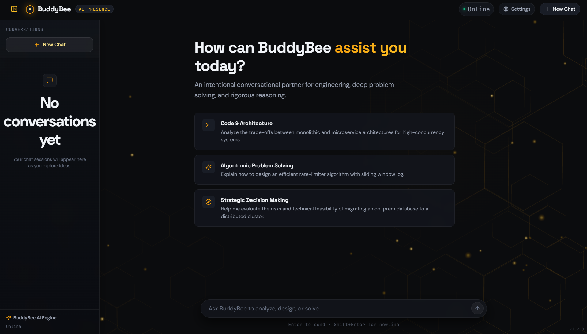
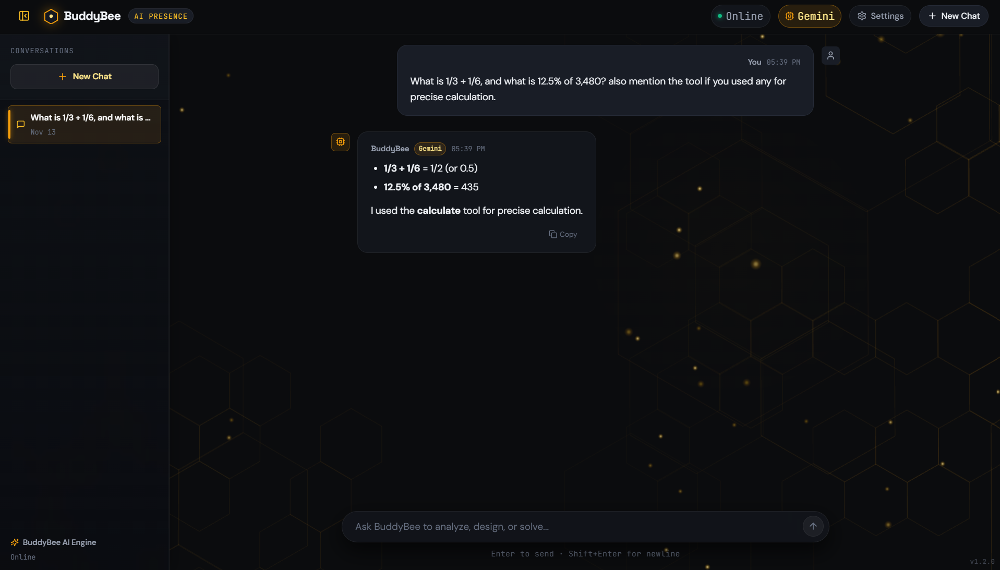
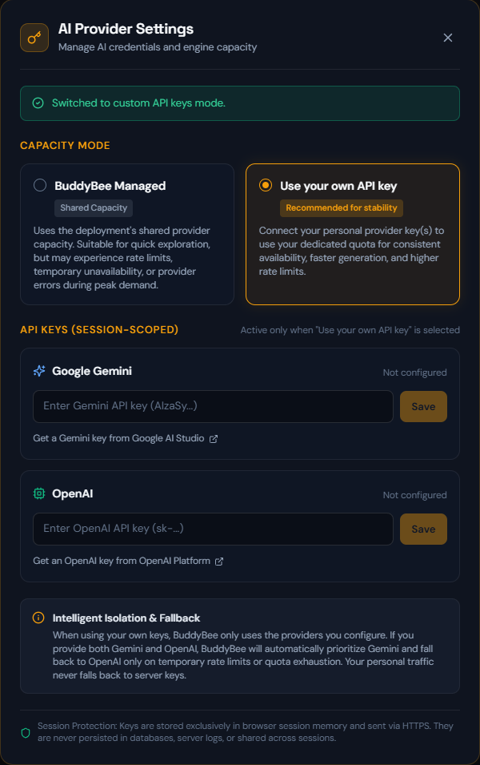

# BuddyBee AI

**An open-source, self-hostable AI assistant framework built around interchangeable AI providers, persistent memory, and practical tools.**

> **Status:** Public v1.2.0 · The hosted demo is currently offline; BuddyBee is a self-host only project.

BuddyBee is designed as an extensible AI assistant environment rather than a wrapper around a single model. It provides a structured application layer that decouples model providers, conversational memory, tools, and persistence, allowing each component to operate and evolve independently.

---

## What is BuddyBee?

BuddyBee is an independent AI assistant project built with a replaceable provider architecture.

Instead of binding the entire application to a single vendor, BuddyBee routes requests through a unified assistant abstraction:

```text
                         +----------------+
                         | Google Gemini  |
                         +----------------+
                                  |
User --> BuddyBee --> AI Router --+
                                  |
                         +----------------+
                         |    OpenAI      |
                         +----------------+

                    + Memory
                    + Tools (Calculator, Time, Web Search)
                    + Persistence (MongoDB / In-Memory)
```

This ensures that routing logic, tool execution, and session management remain consistent regardless of which model powers the response.

---

## Screenshots

<p align="center"><br><em>The empty chat state.</em></p>

<p align="center"><br><em>BuddyBee answering an arithmetic question using the calculate tool.</em></p>

<p align="center"><br><em>The BYOK settings modal.</em></p>

---

## Current Features

### AI Providers & Routing
- **Google Gemini & OpenAI**: First-class support for Gemini and OpenAI models.
- **Provider Abstraction**: Unified `IAIProvider` and `AIRouter` interface for response generation.
- **Automatic Fallback**: Transparent failover between providers on transient failures (quota exhaustion, rate limits, timeouts, or service unavailability). Configuration and authentication errors fail immediately without masking.

### Memory & Persistence
- **Conversation History**: Multi-turn conversational context persisted across sessions.
- **Memory V1**: User-scoped persistent memory injected as background context for personalized responses.
- **Dual Persistence Strategy**: MongoDB persistence with an automatic, zero-configuration in-memory fallback when MongoDB is not configured.

### API Key Modes
- **Managed Mode**: Uses backend environment variables (`GEMINI_API_KEY`, `OPENAI_API_KEY`) configured on the host server.
- **Bring Your Own Key (BYOK)**: Users can supply their own Gemini or OpenAI API keys directly in the frontend Settings modal. Keys are held exclusively in browser session storage and transmitted over HTTPS request headers (`X-Gemini-Api-Key`, `X-OpenAI-Api-Key`), never stored in the database.

---

## Built-in Tools

BuddyBee includes an automatic tool calling engine with support for multi-step tool loops across both Gemini and OpenAI:

### 1. Calculator (`calculate`)
Evaluates mathematical expressions with arbitrary precision:
- Uses a custom parser ([`MathExpressionParser`](BuddyBee.Api/MathExpressionParser.cs)) backed by exact fractions via [`BigRational`](BuddyBee.Api/Services/BigRational.cs) and `BigInteger`.
- Handles addition, subtraction, multiplication, division, right-associative exponentiation (`^`), parentheses, unary operators, percentages (`%`), decimals (e.g. `.5`, `2.5`), and scientific notation (`1.5e3`).
- Strictly rejects division by zero and invalid syntax with controlled error messaging.

### 2. Time (`get_time`)
Returns the current UTC date and time or converts to any specified IANA timezone (e.g., `Asia/Kolkata`, `America/New_York`, `Europe/London`).

### 3. Web Search (`search`)
Performs live internet search powered by the [Tavily Search API](https://tavily.com/):
- Retrieves fresh documentation, recent events, and current data beyond model training cutoffs.
- Extracts titles, source URLs, content snippets, and relevance scores.
- Includes per-request safety controls: throttled to a maximum of 3 searches per turn and deduplicated via in-memory caching.
- Requires configuring `TAVILY__APIKEY` (or `Tavily:ApiKey`).

---

## Architecture

```text
+--------------------------------+
|        React Frontend          |
|    TypeScript + Vite + Three   |
+---------------+----------------+
                |
          HTTPS / JSON
                |
                v
+--------------------------------+
|       ASP.NET Core API         |
|     .NET 10 Web Application    |
|   Rate Limiter (20 req/min/IP) |
|   Forwarded Headers Middleware |
+---------------+----------------+
                |
                v
+--------------------------------+
|           AI Router            |
|       GeminiProvider           |
|       OpenAIProvider           |
|       ToolRegistry             |
+---------------+----------------+
        |               |
        v               v
+---------------+ +--------------+
| Built-in Tools| | Persistence  |
| - Calculator  | | - MongoDB    |
| - Time        | | - In-Memory  |
| - Tavily Search| +--------------+
+---------------+
```

---

## Quick Start

### Run locally

```bash
git clone https://github.com/kayaNK2125/BuddyBee-AI.git
cd BuddyBee-AI
```

#### Prerequisites
- [.NET 10 SDK](https://dotnet.microsoft.com/download/dotnet/10.0)
- [Node.js](https://nodejs.org/) (22) & npm

#### 1. Start Backend API
```bash
cd BuddyBee.Api

# PowerShell:
# $env:GEMINI_API_KEY="your_api_key_here"
# or dotnet user-secrets:
dotnet user-secrets set "GEMINI_API_KEY" "your_api_key_here"

dotnet run
```
The API starts at `http://localhost:5168` (HTTP) / `https://localhost:7177` (HTTPS).
Optional: set TAVILY_API_KEY (or Tavily:ApiKey via user-secrets) to enable the web search tool.

#### 2. Start Frontend
```bash
cd Frontend
npm install
npm run dev
```
Open [http://localhost:5173](http://localhost:5173) in your browser.

### Docker Compose (experimental, not verified)

> **Warning:** The Docker Compose path is experimental, not yet verified end-to-end.

1. **Configure environment variables:**
   ```bash
   cp .env.example .env
   ```
   Edit `.env` to supply at least one provider key (`GEMINI_API_KEY` or `OPENAI_API_KEY`), and optionally `TAVILY__APIKEY`.

2. **Start the containers:**
   ```bash
   docker compose up
   ```
   To also start an optional MongoDB container alongside the API and frontend:
   ```bash
   docker compose --profile mongo up
   ```

3. **Access BuddyBee:**
   Open your browser at [http://localhost:5173](http://localhost:5173).

---

## Configuration

BuddyBee reads settings from environment variables or .NET configuration files (`appsettings.json`):

| Variable | Description | Default |
| :--- | :--- | :--- |
| `GEMINI_API_KEY` | Google Gemini API key for managed requests | Empty (BYOK available) |
| `OPENAI_API_KEY` | OpenAI API key for managed requests | Empty (BYOK available) |
| `TAVILY__APIKEY` | Tavily API key for live web search tool | Empty (Search tool disabled) |
| `MongoDb__ConnectionString` | MongoDB connection URI (e.g. `mongodb://localhost:27017` or `mongodb://mongo:27017`) | Empty (uses in-memory store) |
| `MongoDb__DatabaseName` | MongoDB database name | `BuddyBee` |
| `Cors__AllowedOrigins` | Comma-separated list of allowed frontend origins | `http://localhost:5173` |
| `VITE_API_URL` | Backend URL compiled into frontend assets | `http://localhost:8080` (or `http://localhost:5168`) |

### Important Networking & Deployment Notes
- **`Cors__AllowedOrigins`**: When deploying, set this to the **exact frontend URL** (e.g. `https://your-frontend.example.com` or `http://localhost:5173`), without trailing slashes. Cross-origin browser requests will be rejected if the origin does not match.
- **`VITE_API_URL`**: Must be reachable from the **user's browser**, not the internal Docker network. Because Vite compiles frontend code to execute in client browsers, using container hostnames like `http://api:8080` will fail. Use `http://localhost:8080` for local Docker setups or your public API URL (e.g. `https://api.yourdomain.com`).

---

## Running Tests

BuddyBee includes a comprehensive xUnit test suite for the calculator engine, expression parser, and arbitrary-precision rational arithmetic:

```bash
# Run backend tests
dotnet test

# Run frontend checks
cd Frontend
npm run lint
npm run build
```

---

## Tech Stack

### Frontend
- **React 19** & **TypeScript**
- **Vite**: Build tooling and development server
- **Three.js**: Kinetic 3D Chrysalis ambient presence visualizer
- **React Markdown** & **Remark GFM**: Formatted chat responses
- **Lucide React**: UI iconography
- **Oxlint**: High-performance JavaScript/TypeScript linter

### Backend
- **ASP.NET Core (.NET 10)**
- **Google GenAI SDK** & **OpenAI SDK**
- **MongoDB.Driver**: Persistence layer
- **Microsoft.AspNetCore.RateLimiting**: Client IP-based rate limiting (20 requests/minute fixed window)
- **Microsoft.AspNetCore.HttpOverrides**: Forwarded headers middleware (`X-Forwarded-For`, `X-Forwarded-Proto`)
- **System.Numerics**: Arbitrary-precision math engine

---

## Deployment

The project was previously deployed on the following stack; the hosted demo is currently offline:

```text
Vercel
   |
   v
Railway
   |
   v
MongoDB Atlas
   |
   v
Gemini / OpenAI
```

---

## Roadmap

- **Document intelligence**: Upload and reason over PDFs, notes, and structured data.
- **Grounded web research with citations**: Enhanced source coverage, claim verification, and inline citation synthesis.
- **Composable tool workflows**: Multi-tool execution pipelines that turn conversational intent into actionable outcomes.

---

## Open Source & Contributing

BuddyBee is released under the **GNU Affero General Public License v3.0 (AGPLv3)**. See [LICENSE](LICENSE) for details.

Contributions, bug reports, and suggestions are welcome. Please read [CONTRIBUTING.md](CONTRIBUTING.md) before opening a pull request.

---

## Disclaimer

BuddyBee is an independent project and is not affiliated with, endorsed by, or sponsored by Google, OpenAI, or Tavily. Users and self-hosters are responsible for complying with the respective provider terms, usage limits, and billing agreements.
